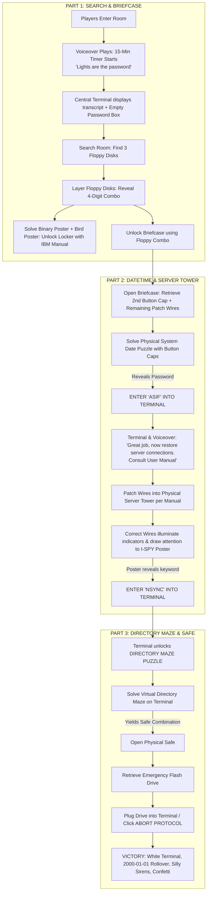

# Project Atlas (Y2K Escape Room) — Figma Context, UI Modification Plan & Complexity Analysis

> **Document Type:** Specification & Architectural Roadmap  
> **Source Project:** Figma Team `1545158976581870141` / Folder `647559508` (*Design Studio Project*)  
> **Target Application:** 1999 Retro CRT Terminal Web Application ([index.html](file:///Users/ritvik/Documents/Y2K/index.html))  
> **Status:** Read-Only Context Extraction & Planning (No project code modified)

---

## 1. Executive Summary & Figma Context

An in-depth inspection of the Figma workspace files was performed using the **Framelink Figma MCP** (`Framelink_Figma_MCP`) and Figma REST API. The team folder contains the design assets, storyboards, physical build plans, and puzzle specifications for the **"Project Atlas: Y2K 11th Hour Escape Room"**.

### 1.1 Scanned Figma Project Files

| File Name | File Key | Last Modified | Description & Contents |
| :--- | :--- | :--- | :--- |
| **GROUP 2** | `rUAyDh5J4qFft5nRWmnp4T` | Oct 22, 2026 | **Primary Master Design Document:** Complete 3-act escape room flow, team task assignments, physical puzzle blueprints, hardware specs (ESP32, server rack, button caps), IBM manual references, story beats, and timeline. |
| **I Spy** | `PlkVbvLR4V7q0ZBTaT0TBa` | Sept 14, 2026 | **Puzzle Graphic Asset:** Visual graphics and item cutouts for Justin's physical I-Spy poster that conceals the Part 2 keyword. |
| **Presentation 10/6** | `mXomWgIMyMLXo2uUO8dF30` | Oct 06, 2026 | **Milestone Review Slides:** Midterm presentation covering unsolved technical problems, proof-of-concept hardware, and physical build feasibility. |
| **Two Ideas** | `ldKdjZbXDjODeZiZjLYCiQ` | Sept 01, 2026 | **Initial Brainstorm:** Early concepts exploring room divider layout, "Overcooked-style" simultaneous tasks, and 90s aesthetic references. |

---

### 1.2 Team Roles & Responsibilities (from Figma Board)

* **Ritvik (Terminal Lead):**
  * Core CRT Terminal software development, state machine, typewriter effect, robotic/Dr. Ferland audio, and user flow execution.
  * Integration of the **Directory Maze Puzzle** (Part 3).
  * Ensuring the terminal meets exact gameplay timings and input requirements.
* **Justin (Graphic Design & Props Lead):**
  * Posters: Binary poster (with translator hint), Bird poster, and I-Spy poster.
  * Locking briefcase, 3-digit/4-digit lockboxes.
  * IBM PC 300PL / IntelliStation-styled physical User Manual with embedded server wiring diagrams.
* **Vikki & Bobby (Hardware & Electronics Leads):**
  * Physical server tower prop (person-height rack with real 1/4" / patch cables and active LEDs).
  * Physical DateTime button-cap puzzle with microswitches.
  * ESP32 microcontroller wiring and sensor integration.
* **Aidan (Advisory / Playtesting):**
  * 3D spatial room model, player testing feedback, and milestone evaluation.

---

## 2. Canonical Escape Room Gameplay Flow

From the authoritative Figma board section **`"Official escape room flow and parts needed"` (#102:218)**:



### Detailed Breakdown of Story Beats

1. **Part 1 (Search & Briefcase):**
   * **Voiceover (Dr. Ferland):** Introduces Y2K crisis, initiates 15-minute countdown, tells players their first task is fixing system dates, and provides the clue: *"Lights are the password"*.
   * **Terminal Screen:** Shows Dr. Ferland's transmission log and an empty prompt waiting for input.
   * **Physical Search:**
     * 3 Floppy disks hidden in the room. When physically stacked/aligned, optical cutouts reveal the 4-digit code to the briefcase.
     * Binary poster + Bird poster provide the code to the locker containing the **IBM User Manual**.
   * **End Goal of Part 1:** Open the briefcase to obtain the missing button cap and the patch wires.

2. **Part 2 (System Date & Server Tower):**
   * **Button Cap Puzzle:** Players place the button caps into the electronic date puzzle box. The resulting indicator lights spell out **`ASIF`** (classic 90s slang).
   * **Terminal Input 1:** Players type **`ASIF`** into the terminal.
   * **Terminal Feedback:** Terminal verifies date calibration and directs players to restore server connections by referencing the IBM User Manual.
   * **Physical Server Tower:** Players connect color-coded wires into specific jacks. Once all wires are routed correctly, a lighting cue draws players' eyes to the **I-Spy poster**.
   * **I-Spy Puzzle:** Poster conceals the boyband keyword **`NSYNC`**.
   * **Terminal Input 2:** Players type **`NSYNC`** into the terminal.

3. **Part 3 (Directory Maze & Safe):**
   * **Terminal Action:** Entering `NSYNC` unlocks the **Directory Maze Puzzle** directly within the terminal interface.
   * **Directory Maze:** Players navigate through simulated directories/logs to find the combination to the physical safe.
   * **Physical Safe:** Contains the Emergency Recovery Drive (USB flash drive or physical key prop).
   * **Climax:** Drive inserted / `[ ABORT EMERGENCY PROTOCOL ]` activated.
   * **Resolution:** Countdown halts, system diagnostics report nominal status, phosphor theme turns calm white, and `JANUARY 1, 2000 - 00:00:00` appears with celebratory sirens and confetti.

---

## 3. Gap Analysis: Current Codebase vs. Figma Specification

A line-by-line review of the current implementation ([terminal.js](file:///Users/ritvik/Documents/Y2K/terminal.js), [index.html](file:///Users/ritvik/Documents/Y2K/index.html), and [README.md](file:///Users/ritvik/Documents/Y2K/README.md)) against the Figma design document reveals key differences:

| Gameplay Element | Current Implementation in `terminal.js` | Official Figma Design Document | Alignment Status |
| :--- | :--- | :--- | :--- |
| **Intro Voiceover & Clue** | Generic Y2K emergency text; no mention of lights or room props. | Specifically mentions 15-minute timer and hints: *"Lights are the password"*. | **Update Needed** |
| **Puzzle 1 Password** | `1999` or `1999-12-31` | **`ASIF`** (Derived from physical button-cap date puzzle) | **Update Needed** |
| **Puzzle 1 Dr. Ferland Dialogue** | Discusses NIST atomic laboratory in Boulder, Colorado. | Congratulates players, instructs them to restore server connections using the IBM manual. | **Update Needed** |
| **Puzzle 2 Password** | `BOULDER` | **`NSYNC`** (Derived from server wire patching + I-Spy poster) | **Update Needed** |
| **Puzzle 2 Dr. Ferland Dialogue** | Mentions orbital defense satellite and SSH port 22. | Alerts players that server links are up, prompting the terminal Directory Maze. | **Update Needed** |
| **Part 3 Gameplay Mechanic** | Simple text input asking for `ATLAS-2000` (floppy label) then shows Abort button. | **Directory Maze Puzzle**: Terminal unlocks an interactive virtual filesystem/maze that yields the safe combo. | **Major Feature Missing** |
| **Victory Trigger** | Click ASCII `[ ABORT EMERGENCY PROTOCOL ]` button. | Safe contains flash drive/media; abort button or USB plug triggers finale. | **Compatible** (can chain maze -> combo -> abort) |
| **Audio Synthesis** | `audio/puzzle1.wav` ("Please add password 1"), etc. | Needs audio matching Dr. Ferland's exact lines ("Lights are the password", "Restore server connections", etc.). | **Audio Refinement** |
| **Hardware Hooks (ESP32)** | Pure client-side browser events only. | Figma notes specify 3 ESP32s for electronic date puzzle & server tower. | **Optional API / Webhook** |

---

## 4. UI Modification & Implementation Plan

To bring the terminal to 100% fidelity with Group 2's Figma design, the following architectural updates are planned:

### Phase 1: State Machine & Password Realignment (Low Effort)
* **Update State Passwords in [terminal.js](file:///Users/ritvik/Documents/Y2K/terminal.js):**
  * `PUZZLE_1` validation: Accept `ASIF` (case-insensitive) as primary solution. Maintain fallback/alias for testing.
  * `PUZZLE_2` validation: Accept `NSYNC` (case-insensitive) as primary solution.
* **Update Narrative Copy & Dr. Ferland Dialogues:**
  * **Intro:** Incorporate *"Lights are the password"* and guidance on the physical button caps.
  * **After `ASIF`:** Prompt players: *"SYSTEM DATE STABILIZED. SERVER CONNECTIONS SEVERED. CONSULT IBM PC TECHNICAL REFERENCE MANUAL TO RE-WIRE TOWER INTERFACES."*
  * **After `NSYNC`:** Prompt players: *"SERVER PACKETS SYNCHRONIZED. EMERGENCY SYSTEM DIRECTORY UNLOCKED. COMMENCING DEEP STORAGE MAZE NAVIGATION..."*

### Phase 2: Directory Maze Puzzle Implementation (Medium/High Effort)
The Figma board explicitly designates Part 3 as a **"Directory Maze Puzzle"** that players solve on the terminal to acquire the safe code. Two architectural approaches are possible:

#### Option A: Virtual Terminal Filesystem CLI (Recommended for Authenticity)
* Players use authentic DOS commands: `dir` / `ls`, `cd <folder>`, `type <file>` / `cat <file>`.
* A multi-level labyrinth of subdirectories (e.g., `/SYS/DRV/`, `/SECTOR_07/`, `/VAULT/`, `/CORRUPT/`).
* Some folders are dead ends, corrupted, or password-locked; following clues from the IBM manual guides players to the terminal leaf node containing `SAFE_COMBINATION.LOG` (e.g., Code `8492`).

#### Option B: Interactive ASCII Grid Maze (Recommended for Visual Polish)
* The CRT screen shifts into an interactive retro ASCII grid renderer (`[#]`, `[.]`, `[@]`).
* Players navigate using Arrow keys / WASD through mainframe memory sectors to reach the decryption node.
* On reaching the exit node, the screen outputs the safe combination.

### Phase 3: Flash Drive / Abort Protocol Climax (Low Effort)
* Once the safe is opened and the flash drive retrieved:
  * Terminal displays `AWAITING RECOVERY DRIVE MOUNT...` (or a command `mount d:` / typing the code on the flash drive).
  * Immediately triggers the existing flashing red alert:
    `EMERGENCY RECOVERY DRIVE DETECTED. FINAL AUTHORIZATION REQUIRED.`
  * The large ASCII `[ ABORT EMERGENCY PROTOCOL ]` button is revealed.
  * Triggering abort runs the established white-phosphor victory rollover.

### Phase 4: Audio & Hardware Extension Hooks (Medium Effort)
* **Voice Synthesis & Prompts:**
  * Update speech synthesizer or audio recordings to speak the new clues:
    * *"Please enter system date password."*
    * *"System date verified. Restore server connections."*
    * *"Server network online. Directory maze unlocked."*
* **ESP32 Microcontroller Integration (WebSerial API):**
  * Add an optional toggle for `navigator.serial` so if Vikki and Bobby connect an ESP32 over USB, puzzle events can auto-complete in real-time when physical wires or buttons are pressed.

---

## 5. Technical Complexity & Effort Assessment

```
+-------------------------------------------------------------------------+
|                        COMPLEXITY BREAKDOWN                             |
+-------------------------------------------------------------------------+
| Task Category                   | Complexity | Estimated Dev Time       |
+---------------------------------+------------+--------------------------+
| 1. Password & Text Alignment    | LOW        | 0.5 - 1.0 hours          |
| 2. Dr. Ferland Dialogue Updates | LOW        | 0.5 - 1.0 hours          |
| 3. Audio Prompts Generation     | LOW        | 1.0 - 1.5 hours          |
| 4. Directory Maze (CLI Mode)    | MEDIUM     | 2.5 - 4.0 hours          |
|    OR Directory Maze (ASCII UI) | HIGH       | 4.0 - 6.0 hours          |
| 5. Safe -> Abort Transition     | LOW        | 0.5 - 1.0 hours          |
| 6. ESP32 WebSerial Bridge (Opt) | MEDIUM     | 2.0 - 3.0 hours          |
+---------------------------------+------------+--------------------------+
| TOTAL ESTIMATED EFFORT          | MODERATE   | 5.0 - 8.5 hours          |
+-------------------------------------------------------------------------+
```

### Risk & Constraint Summary
1. **Pacing in 15 Minutes:** A 15-minute countdown is tight for an escape room with physical search, wiring, and terminal navigation. The Directory Maze must be intuitive with clear breadcrumb clues so players don't get stuck in a syntax trap.
2. **Audio Clashing:** Ensure voiceover cues and keyboard clatter do not talk over each other; all audio queues should cleanly chain with typewriter completion events.
3. **Preservation Guarantee:** The existing CRT visual shaders (scanlines, vignette, bloom, screen curvature) and responsive layouts are working smoothly and must remain strictly untouched during any logic upgrades.

---

## 6. Next Steps & Execution Readiness

When instructed by the user to proceed with development:
1. Apply the state machine password adjustments (`ASIF`, `NSYNC`) to [terminal.js](file:///Users/ritvik/Documents/Y2K/terminal.js).
2. Choose between **Option A (CLI Filesystem Maze)** or **Option B (Visual ASCII Grid Maze)** for the Part 3 implementation.
3. Update Dr. Ferland's dialogue scripts and audio files.
4. Run comprehensive end-to-end testing across desktop and responsive display viewports.
